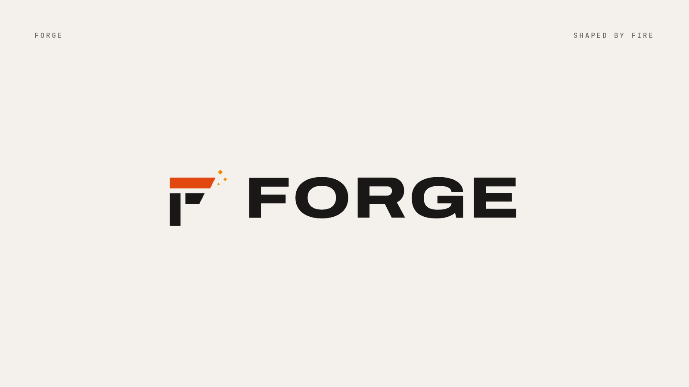
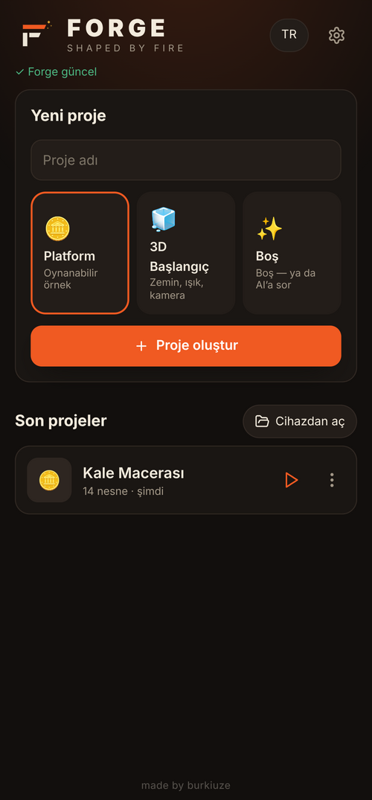
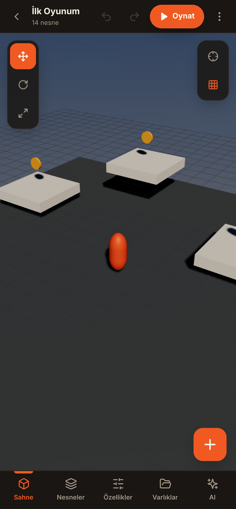
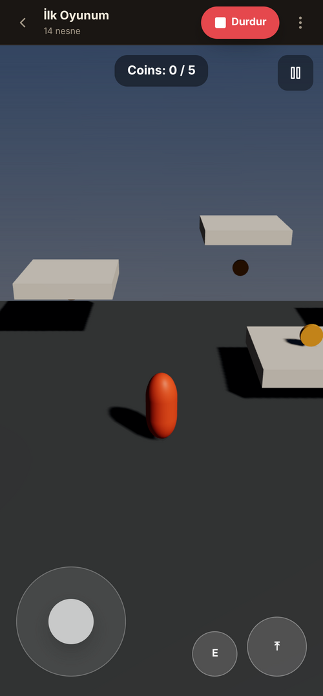
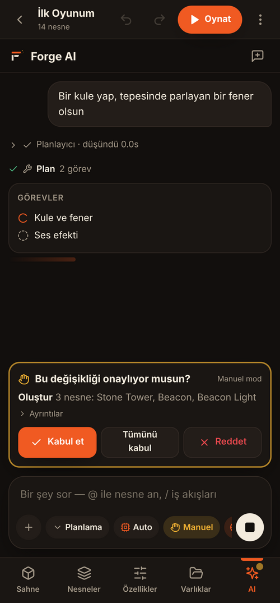
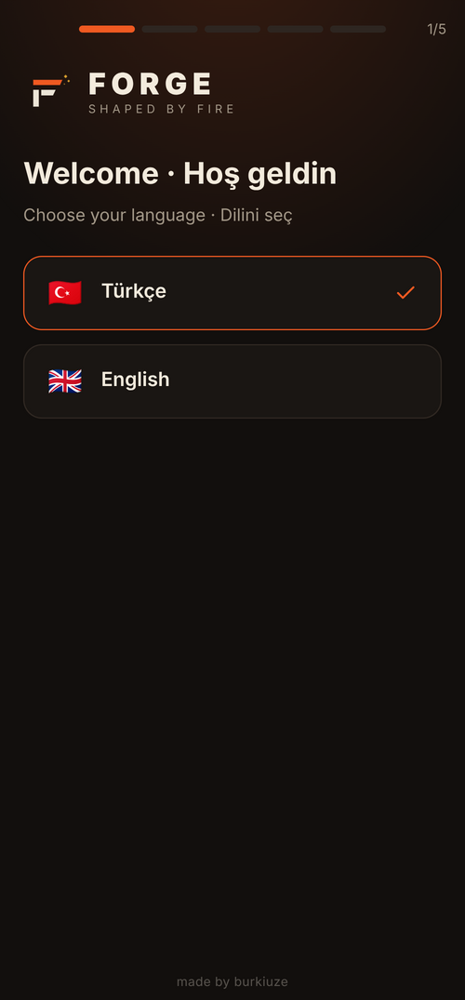
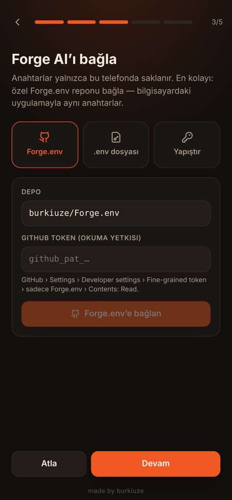
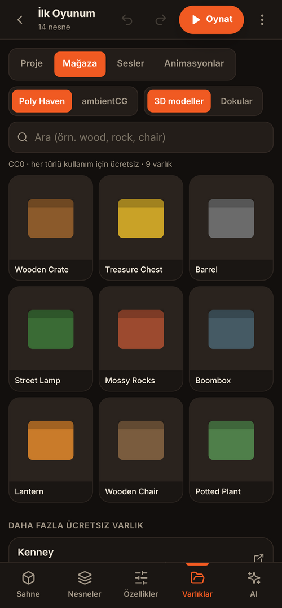
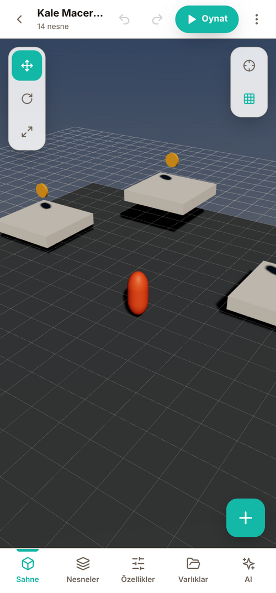

<p align="center"></p>

# Forge Mobile

**Forge’un telefon sürümü.** Bilgisayardaki [Forge](https://github.com/burkiuze/Forge) editörüyle aynı sahne dosyaları, aynı Rhai betikleri, aynı varlık klasörleri ve aynı yapay zekâ ajanları — dokunmatik ekran için yeniden tasarlandı.

*The phone edition of Forge: same scenes, scripts, assets and AI agents as the desktop editor, redesigned for touch.*

| Başlangıç | Editör | Oyun modu | Forge AI (Manuel onay) |
|---|---|---|---|
|  |  |  |  |
| **Kurulum sihirbazı** | **Forge.env bağlantısı** | **Varlık mağazası** | **Açık tema (Kemik)** |
|  |  |  |  |

## Özellikler

- **Editör:** 3D sahne (dokunmatik döndür / kaydır / yakınlaştır, çift dokunuşla odak), taşı-döndür-ölçekle gizmoları, yapışma, ızgara, nesne ağacı, ayrıntılı Inspector (Transform, malzeme, doku, desen, ışıma, çarpıştırıcı, Rigidbody, ışık, kamera, ses kaynağı, animatör, betik), geri al / yinele, otomatik kayıt.
- **Oyun modu:** masaüstüyle aynı fizik ve betik API’si; sanal joystick (W/A/S/D), zıplama (SPACE) ve aksiyon (E) düğmeleri, HUD, takip kamerası, sesler, animasyonlar.
- **Betikler:** Forge’un Rhai betikleri telefonda da çalışır (Rhai → JS çevirici). Şablonlar ve kod parçacığı çubuğu.
- **Varlıklar:** cihazdan içe aktarma (glTF/GLB, PNG/JPG, WAV/MP3/OGG, .rhai, .anim.json), Poly Haven ve ambientCG’den ücretsiz CC0 model/doku indirme, 8 hazır ses efekti üretici, 10 hazır animasyon, anahtar kareli animasyon editörü.
- **Forge AI:** Planlayıcı → Kurucu → Denetçi ajanları, alt ajanlar (Kâşif, Kodlayıcı), görev listesi, telefondan web araması, ajan hafızası (yerleşik veya TencentDB Agent Memory). **Önce varlık** kuralı: karakter/obje ilkel şekillerden yapılmaz, gerçek modeller bulunup indirilir. **✋ Manuel** (her değişiklik için Kabul / Tümünü kabul / Reddet) veya **⚡ Auto** izin modu, tur başına “Geri al”.
- **Modeller:** OpenRouter (Auto, Gemma 4 31B, Mercury Decide, North Mini Code, Inkling Small, istediğin model kimliği) ya da Wi‑Fi’daki bilgisayarında çalışan llama.cpp / Ollama / LM Studio.
- **Forge.env:** anahtarlar uygulamaya gömülmez. Özel `burkiuze/Forge.env` reposundaki `.env` dosyası salt-okunur bir GitHub token ile okunur (ya da `.env` dosyası seçilir / anahtar yapıştırılır) ve yalnızca telefonun özel depolamasında tutulur.
- **Temalar:** Kor (varsayılan), Obsidyen, Gece, Kemik (açık) + 6 vurgu rengi, arayüz boyutu.
- **Güncellemeler:** açılışta GitHub Releases denetlenir, yeni sürüm varsa “Şimdi güncellensin mi?” diye sorulur.
- **PC ile uyum:** projeyi `.scene.json` olarak dışa aktar → bilgisayardaki Forge’da aç; PC’deki sahneyi “Cihazdan aç” ile telefona al.
- Türkçe / English.

## Kurulum

[Releases](https://github.com/burkiuze/ForgeMobile/releases) sayfasından `Forge-Mobile.apk` dosyasını indir ve kur (Android “bilinmeyen uygulamalara izin ver” isteyebilir). `Forge-Mobile.aab` Google Play’e yüklemek içindir.

## Geliştirme

```bash
npm install
npm run dev        # tarayıcıda (masaüstü tarayıcı veya telefon)
npm test           # çekirdek + ajan testleri
npm run build      # dist/ → app/src/main/assets/www
```

Android kabuğu (`app/`) bir WebView’dir; `window.ForgeNative` köprüsü CORS’suz HTTP, gizli anahtar deposu, dosya kaydetme ve sistem çubuğu renklerini sağlar. GitHub Actions (`.github/workflows/android.yml`) her `main` push’unda APK + AAB üretir.

### İmzalı sürümler

Repo ayarlarında (Settings › Secrets and variables › Actions) şu dört secret tanımlıysa CI imzalı `build-N` sürümü yayınlar ve uygulamalar kendini günceller:

| Secret | İçerik |
|---|---|
| `ANDROID_KEYSTORE_BASE64` | `forge-upload.jks` dosyasının base64 hali |
| `ANDROID_STORE_PASSWORD` | keystore şifresi |
| `ANDROID_KEY_PASSWORD` | anahtar şifresi |
| `ANDROID_KEY_ALIAS` | `upload` |

Secret yoksa çıktılar imzasız olarak `unsigned-latest` ön sürümüne konur.

<p align="center"><sub>made by burkiuze</sub></p>
